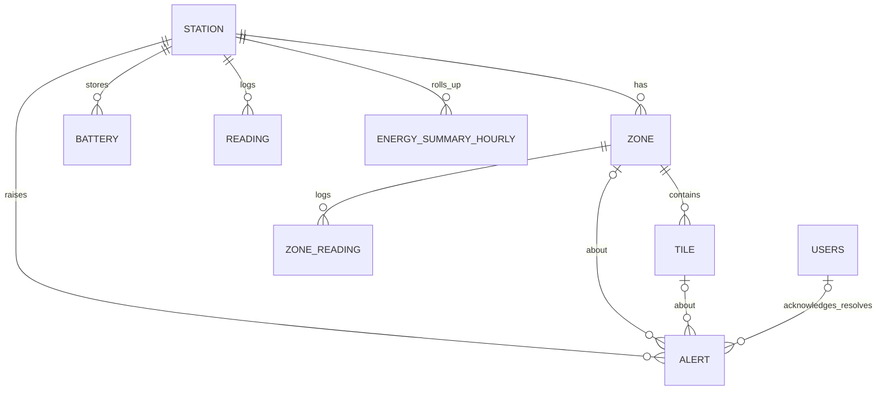

# PadaShakti — Database Design

MySQL 8 · InnoDB · utf8mb4 · schema managed by **Flyway** (`src/main/resources/db/migration`).
Hibernate runs with `ddl-auto=validate`, so it never changes tables. Every change is a new `V<n>__*.sql` file.

## Migrations

| File | What it does |
|---|---|
| `V1__create_schema.sql` | Creates all 9 tables, keys, checks and indexes |
| `V2__seed_station_zones_tiles.sql` | Chennai Central station, 6 zones, 190 tiles, battery bank |
| `V3__seed_demo_users.sql` | 3 demo users (BCrypt passwords) |
| `V4__seed_history_and_alerts.sql` | 7 days of hourly energy history + starting alerts |

> Never edit a migration that already ran. Add a new `V5__...sql` instead.

## ER diagram



## Tables

| Table | Purpose | Key columns |
|---|---|---|
| `users` | Control-centre logins | username, email, password_hash, role (ADMIN/OPERATOR/ENGINEER) |
| `station` | Metro station | code, name, city, daily_footfall_estimate, layout_width/height |
| `zone` | Area in a station | zone_type, traffic_weight, max_capacity, pos_x/pos_y/width/height, grid_rows/cols |
| `tile` | Kinetic floor tile (IoT node) | tile_code, tile_type (PIEZO/ELECTROMAGNETIC), status, health_pct, pos_x/pos_y, rated_joules_per_step, steps/energy counters |
| `battery` | Storage bank | capacity_wh, charge_wh, temperature_c, cycle_count, status |
| `reading` | Live station snapshot per simulation tick (pruned to 24 h) | steps, energy_j, power_w, battery_pct, active_tiles |
| `zone_reading` | Live per-zone snapshot | steps, energy_j, occupancy, density_pct |
| `energy_summary_hourly` | Hourly roll-up for analytics/reports | steps, energy_j, avg/peak power, footfall |
| `alert` | Faults, battery, crowding | alert_type, severity, status, ack/resolve user + time |

## Seed data summary

- **Station:** Chennai Central Metro (`CHC`), about 110,000 passengers a day
- **Zones:** Entry Gates, Stairs & Escalators, Concourse, Platform 1, Platform 2, Exit Gates
- **Tiles:** 190 (64 electromagnetic at 4.0 J, 126 piezo at 2.5 J). 2 faulty, 3 degraded, 1 in maintenance
- **Battery:** 2 kWh LiFePO4, starts at 60%
- **History:** 168 hourly rows, about 0.55–0.6 kWh harvested per day
- **Users:**

| Username | Password | Role |
|---|---|---|
| admin | Admin@123 | ADMIN |
| operator | Operator@123 | OPERATOR |
| engineer | Engineer@123 | ENGINEER |

## Design decisions

- **CHECK constraints** stand in for enums, so bad values can't enter the database.
- **`version` columns** on `tile` and `battery` give optimistic locking, because the simulator updates them every tick.
- **Raw vs roll-up:** `reading` / `zone_reading` hold high-frequency live data and `energy_summary_hourly` holds long-term history. This keeps charts fast.
- **Layout coordinates** are stored in the database, so the React floor map draws itself from data rather than hard-coded positions.
- **Timestamps** use `DATETIME(3)` (millisecond precision), stored in IST (Asia/Kolkata), same as the MySQL server.

## Reset the database (dev only)

```sql
DROP DATABASE padashakti;
```

Restart the backend. Flyway recreates everything.
